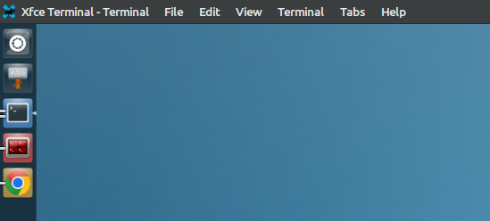

# Lunatic

Unity's launcher and global menu, reimplemented in C with minimal dependencies and support for multiple desktop environments.

- [launcher/](launcher/README.md): Unity launcher port, including upstream snapshot, artwork, tests and documentation.
- [panel/](panel/README.md): global-menu implementation, with shared C code in `panel/common/` and a dedicated plugin for each desktop environment. Currently includes an Xfce adapter in `panel/xfce-plugin/`.

<p align="center">
  
</p>

## Build

```sh
make                         # launcher only; no panel dependencies
./launcher/unity-launcher
make panel                   # optional Xfce global-menu plugin
make check                   # both components' checks
make check-install           # staged install/uninstall and Xfce path pairing
```

## Install

From the repository root, install both the launcher and panel integration:

```sh
sudo make install
xfce4-panel -r
```

Root `make install` builds and installs both components. After reloading the
panel, the global menu shows the title followed by its menus. Right-click the
item and choose **Properties** to change the maximum title width.

Use `make install-launcher` or `make install-panel` to install one component.
`PREFIX`, `LIBDIR`, `GTK_MODULEDIR` and `DESTDIR` can be overridden for packaging;
see [panel installation](panel/README.md). Root `make uninstall` removes both
components; `uninstall-launcher` and `uninstall-panel` remove them separately.
Launcher configuration and executable names remain unchanged.
